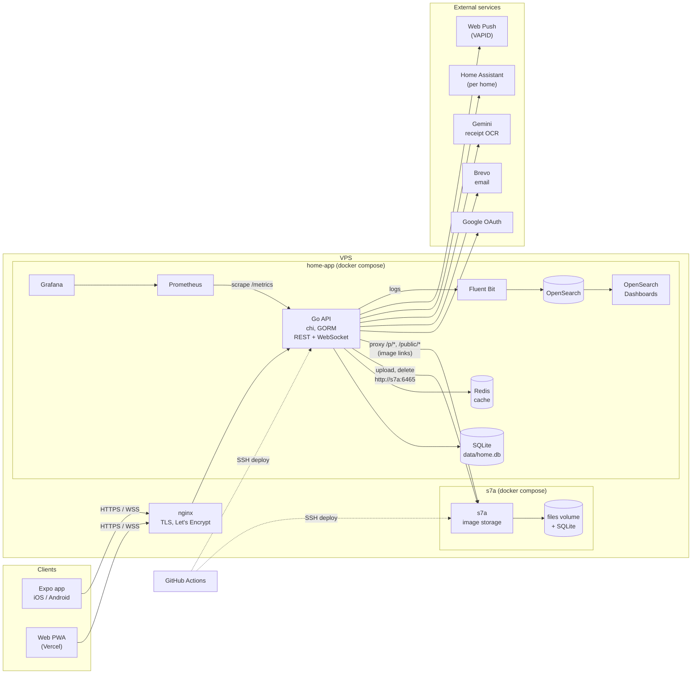
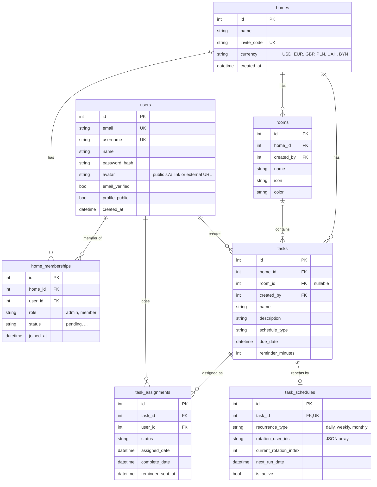
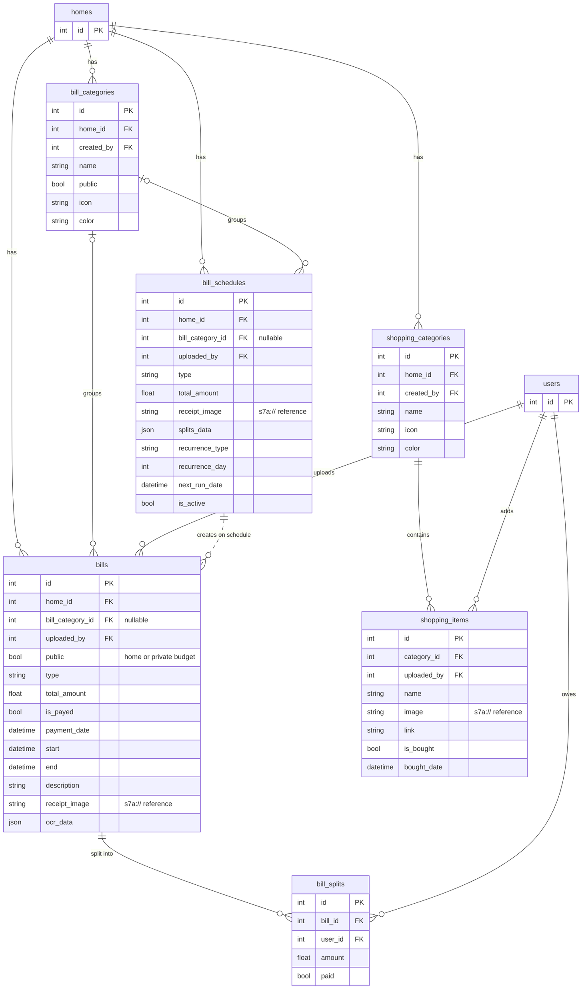
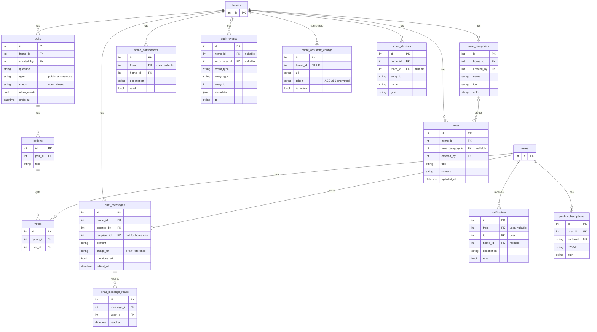

# Household Manager App

This repository now contains the monorepo root. The Expo client lives in `client/` and has its own README:

[Client README](./client/README.md)

## Tech Stack

[]()


- **API**: Go, chi, GORM, WebSockets, Swagger
- **Client**: Expo / React Native (iOS, Android, web PWA on Vercel), Zustand, NativeWind
- **Data**: SQLite (production), Postgres (still supported), Redis cache
- **Files**: [s7a](https://github.com/Dragodui/s7a), self-hosted storage on the same server (Cloudflare R2 still supported)
- **Ops**: Docker Compose, nginx + Let's Encrypt, GitHub Actions deploy over SSH, Prometheus + Grafana, Fluent Bit + OpenSearch

## App Architecture



- Every request goes through nginx to the Go API. Routes live under `/api/homes/{home_id}/...` and check home membership or admin role.
- Real-time updates (tasks, bills, polls, chat and so on) go to clients over the WebSocket at `/ws`.
- Images go to s7a. Avatars are public with permanent links. Receipts and chat and shopping photos are private: the database keeps an `s7a://` reference, and the API returns a fresh signed link each time. The API serves both kinds of links itself by proxying `/p/*` and `/public/*` to s7a, so s7a is not exposed to the internet.
- A push to `main` runs tests, then deploys over SSH (`git reset --hard origin/main && docker compose up -d --build`).

## Database Schema

Generated from the GORM models in `internal/models` (`internal/database/migrate.go` lists them). Split by domain for readability; `users` and `homes` appear in every part.

### Users, homes and tasks



### Bills and shopping



### Polls, notes, chat, notifications and smart home



Mentions are many-to-many join tables, created by GORM:

- `note_{user,task,bill,shopping_item,note_category,bill_category,shopping_category}_mentions`
- `chat_message_{user,task,bill,shopping_item,note_category,bill_category,shopping_category}_mentions`

## API Documentation

This project uses Swagger for API documentation.

- **Swagger UI**: Access the interactive API documentation at `http://localhost:8000/swagger/index.html` when the server is running.
- **Spec Files**: The raw Swagger specification files are located in the `docs/` directory (`swagger.json`, `swagger.yaml`).

## Monitoring & Observability

The application includes comprehensive monitoring with Prometheus and Grafana.

### Available Metrics

| Category | Metrics |
|----------|---------|
| **HTTP** | Request count, duration, in-flight requests, response size |
| **Database** | Query count, duration, connections, errors |
| **Redis** | Operations, cache hits/misses, operation duration |
| **Authentication** | Login attempts, token generation, validation |
| **S3** | Upload count, duration, file size |
| **Business** | Homes, tasks, bills, shopping items, polls |
| **Email** | Sent emails by type and status |
| **OCR** | Request count and processing duration |

### Accessing Monitoring

| Service | URL | Credentials |
|---------|-----|-------------|
| Prometheus | `http://localhost:9090` | - |
| Grafana | `http://localhost:3000` | admin / admin |
| Metrics Endpoint | `http://localhost:8000/metrics` | - |

### Grafana Dashboard

A pre-configured dashboard "Household Manager API" is automatically provisioned with panels for:

- **Overview**: Uptime, request rate, error rate, P95 latency, active users
- **HTTP Metrics**: Request rate by status, latency percentiles, top endpoints
- **Database Metrics**: Queries by operation, query latency, connections
- **Redis Metrics**: Operations by type, cache hit/miss rate
- **Authentication**: Login attempts, token validation
- **Business Metrics**: Homes, tasks, bills, shopping items, polls
- **External Services**: S3 uploads, email sends, OCR requests

## Configuration

The application is configured with environment variables, all read in `internal/config/config.go`. Start from the example file:

```bash
cp .env.example .env
```

For Docker-based local development, the tracked `.env.dev` already has safe dev defaults for PostgreSQL and Redis.

### Environment Variables

**Core**

| Variable | Required | Description | Example / default |
|----------|----------|-------------|-------------------|
| `MODE` | no | `dev` or `prod`. Outside `dev`, `JWT_SECRET` and `HA_ENCRYPTION_KEY` lengths are checked and HSTS is on | `dev` |
| `PORT` | no | API port | `8000` |
| `DB_DRIVER` | no | `postgres` or `sqlite` (production uses SQLite) | `postgres` |
| `DB_DSN` | yes | Postgres DSN, or SQLite file path | `./data/home.db` |
| `REDIS_ADDR` | yes | Redis address | `redis:6379` |
| `REDIS_PASSWORD` | no | Redis password | |
| `REDIS_TLS` | no | `true` to connect to Redis over TLS | `false` |
| `SERVER_URL` | yes | Public URL of this API | `https://api.example.com` |
| `CLIENT_URL` | yes | App URL, allowed by CORS | `http://localhost:8081` |
| `WEB_URL` | no | Web client URL, allowed by CORS | `http://localhost:8082` |

**Auth and security**

| Variable | Required | Description | Example / default |
|----------|----------|-------------|-------------------|
| `JWT_SECRET` | yes | JWT signing key, at least 32 chars outside `dev` | |
| `GOOGLE_CLIENT_ID` | yes | Google OAuth client ID | |
| `GOOGLE_CLIENT_SECRET` | yes | Google OAuth client secret | |
| `CLIENT_CALLBACK_URL` | yes | OAuth callback URL | `http://localhost:8000/auth/google/callback` |
| `HA_ENCRYPTION_KEY` | yes | AES-256 key for Home Assistant tokens, exactly 32 chars | |
| `ADMIN_USERNAME` | yes | Basic Auth for `/metrics` and `/swagger`, Grafana admin | `admin` |
| `ADMIN_PASSWORD` | yes | Same, password | |

**File storage**

| Variable | Required | Description | Example / default |
|----------|----------|-------------|-------------------|
| `STORAGE_PROVIDER` | no | `s7a` (self-hosted, used in production) or `r2` (Cloudflare R2) | `r2` |
| `S7A_URL` | no | s7a API address, reachable from the backend | `http://s7a:6465` |
| `S7A_API_KEY` | for `s7a` | Same value as `API_KEY` in the s7a `.env` | |
| `S7A_PUBLIC_URL` | no | Base of file links for clients | `SERVER_URL` |
| `S7A_PUBLIC_BUCKET` | no | Bucket for avatars (permanent links) | `home-public` |
| `S7A_PRIVATE_BUCKET` | no | Bucket for receipts, chat and shopping photos (expiring links) | `home-private` |
| `R2_ACCESS_KEY_ID`, `R2_SECRET_ACCESS_KEY`, `R2_ACCOUNT_ID`, `R2_S3_BUCKET`, `R2_PUBLIC_URL` | for `r2` | Cloudflare R2 credentials and public bucket URL | |
| `R2_REGION` | no | R2 region | `auto` |

**Integrations**

| Variable | Required | Description | Example / default |
|----------|----------|-------------|-------------------|
| `BREVO_API_KEY` | yes | Brevo HTTP API key for emails | |
| `SMTP_FROM` | no | Sender address for emails | `no-reply@example.com` |
| `SMTP_HOST`, `SMTP_PORT`, `SMTP_USER`, `SMTP_PASSWORD` | no | Legacy SMTP, local dev only | |
| `GEMINI_API_KEY` | no | Gemini API key for receipt OCR | |
| `VAPID_PUBLIC_KEY`, `VAPID_PRIVATE_KEY` | yes | Web Push keys | |
| `VAPID_SUBJECT` | no | Web Push contact | `mailto:contact@example.com` |

### Grafana Variables

| Variable | Description | Default |
|----------|-------------|---------|
| `ADMIN_USERNAME` | Grafana admin username (shared with app basic auth) | `admin` |
| `ADMIN_PASSWORD` | Grafana admin password (shared with app basic auth) | `admin` |
| `GRAFANA_ROOT_URL` | Grafana public URL | `http://localhost:3000` |

## Running the Application

### Development (Docker)

Runs the API with hot reload (air), PostgreSQL, Redis and the full monitoring stack:

```bash
docker compose -f docker-compose.dev.yaml up --build   # or: make docker-up
```

| Service | URL |
|---------|-----|
| API | `http://localhost:8000` |
| Swagger UI | `http://localhost:8000/swagger/index.html` (Basic Auth) |
| Prometheus | `http://localhost:9090` |
| Grafana | `http://localhost:3000` |
| OpenSearch Dashboards | `http://localhost:5601` |
| PostgreSQL | `localhost:5432` |
| Redis | `localhost:6379` |

### Local Development (without Docker)

Only Redis is needed when you use SQLite:

```bash
# .env: DB_DRIVER=sqlite, DB_DSN=./data/home.db, REDIS_ADDR=localhost:6379
go run cmd/server/main.go   # or: make run, or `air` for hot reload
```

Tests: `make test` (same as CI, `go test -v ./tests/...`). After changing handler annotations, regenerate Swagger with `make swagger`.

The Expo client has its own commands in [client/README.md](./client/README.md).

### Production

Production runs on one VPS with `docker-compose.yaml`:

- **API** container `go-backend` on port `8000`, behind nginx with Let's Encrypt TLS.
- **Database**: SQLite at `./data/home.db` on the host (mounted into the container), so it survives rebuilds.
- **Files**: [s7a](https://github.com/Dragodui/s7a) runs as a separate Compose project on the same server. Its server-only `docker-compose.override.yml` joins `home-app_app-network`, so the backend reaches it at `http://s7a:6465`. Set `STORAGE_PROVIDER=s7a` and `S7A_API_KEY` in `.env`.
- **Deploy**: a push to `main` runs `.github/workflows/ci-cd.yml`. It runs tests and a Docker build, then over SSH runs `git reset --hard origin/main && docker compose up -d --build` in the app directory. `.env` and `data/` are not tracked, so deploys keep them.

To run the production stack by hand:

```bash
cp .env.example .env   # fill in real values
docker compose up --build -d   # or: make docker-up-prod
```

Moving old files from Cloudflare R2 to s7a: `go run ./cmd/migrate-r2-s7a -h`. Moving data from Postgres to SQLite: `cmd/migrate-pg-sqlite`.

## Project Structure

```
home-app/
├── cmd/
│   ├── server/              # API entry point and composition root (app.go wires repos, services, handlers)
│   ├── migrate-pg-sqlite/   # one-off copy of data from Postgres to SQLite
│   └── migrate-r2-s7a/      # one-off copy of files from Cloudflare R2 to s7a
├── internal/
│   ├── cache/               # Redis client
│   ├── config/              # all env config in one struct
│   ├── database/            # Postgres / SQLite connection, AutoMigrate model list
│   ├── event/               # WebSocket event types
│   ├── http/
│   │   ├── middleware/      # auth, home membership and roles, rate limits, metrics, logging, security headers
│   │   ├── rate_limiter/    # IP rate limiter
│   │   └── websocket/       # WebSocket hub for real-time updates
│   ├── logger/              # structured logging
│   ├── metrics/             # Prometheus metrics, GORM plugin
│   ├── models/              # GORM models and request/response DTOs, file link hooks
│   ├── modules/             # one package per domain: handler.go, service.go, repository.go
│   │   ├── audit/  auth/  billing/  chat/  home/  image/  note/
│   │   └── notification/  poll/  room/  shopping/  smarthome/  task/  user/
│   ├── router/              # all routes (chi), file link proxy to s7a
│   └── utils/               # responses and errors, validation, mailer, encryption, tokens, URL checks
├── pkg/security/            # JWT and hashing helpers
├── tests/                   # black-box tests: middleware/, models/, modules/<domain>/, router/, testutil/
├── client/                  # Expo / React Native app (see client/README.md)
├── monitoring/              # Prometheus, Grafana dashboards and provisioning, Fluent Bit configs
├── docs/                    # generated Swagger (make swagger)
├── docker-compose.yaml      # production stack
├── docker-compose.dev.yaml  # dev stack with Postgres and hot reload
├── Dockerfile
├── Dockerfile.dev
└── Makefile
```
